<p align="center">
  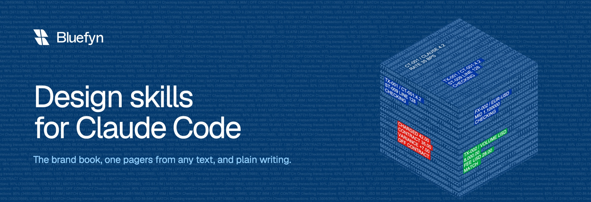
</p>

<p align="center">
  <a href="LICENSE"></a>
  
  
  
</p>

# Bluefyn design skills

Four skills for [Claude Code](https://claude.com/claude-code), made by [Bluefyn](https://bluefyn.ai).
Two of them make documents and pages in the Bluefyn brand. The other two make writing plainer.

Give Claude your call notes and get back a one-page PDF that follows the brand book:

```
Make a one pager for Acme Pay from these call notes: ...
```

<p>
  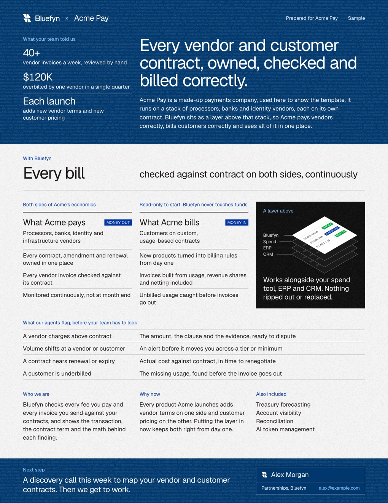
  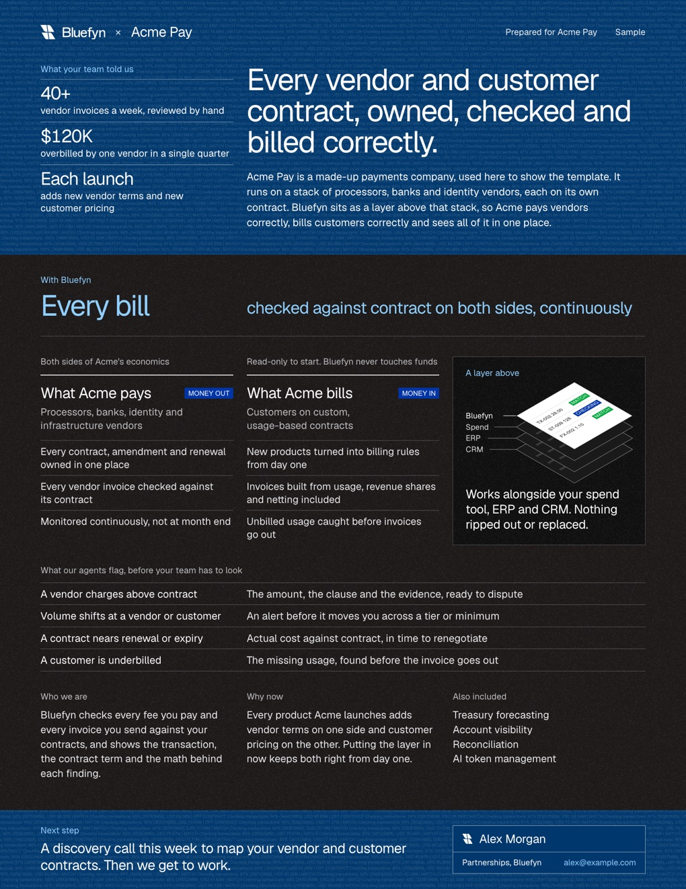
</p>

Acme Pay is a made-up company, and so are its figures. The page is built from
[acme.json](skills/bluefyn-one-pager/examples/acme.json).

## The skills

| Skill | What it does | How to start it |
| --- | --- | --- |
| `bluefyn-design` | Holds the brand book (colors, type, logo, graphics, layout rules, what to leave out) and a design method for layout and copy. Claude uses it for any Bluefyn-branded piece. | Ask for a branded page, slide, poster or PDF, or type `/bluefyn-design` |
| `bluefyn-one-pager` | Turns any text into a one-page PDF in the Bluefyn brand, light or dark. | Ask for a one pager, or type `/bluefyn-one-pager` |
| `bluefyn-unslop` | Removes AI tells from prose, such as em dashes, filler and hype words. | Type `/bluefyn-unslop`, or ask for a final pass on some writing |
| `bluefyn-bro` | Restates Claude's last answer in plain language. | Type `/bluefyn-bro` |

## Quick start

```bash
git clone https://github.com/bluefyn/design-skills.git
```

```bash
cd design-skills && ./install.sh
```

Start a new Claude Code session and type `/bluefyn`. The four skills appear in the menu.

Or make a design workspace with one command and no clone. It is a folder with the skills, the brand
files and a one pager builder, ready to open in Claude Code:

```bash
curl -fsSL https://raw.githubusercontent.com/bluefyn/design-skills/main/install.sh | sh -s -- --workspace ~/bluefyn-design
```

## The brand book

`bluefyn-design` carries the brand book as rules Claude reads and as a PDF for people. These are eight of
its ten pages. The full book is [brand-book.pdf](skills/bluefyn-design/references/brand-book.pdf).

<p>
  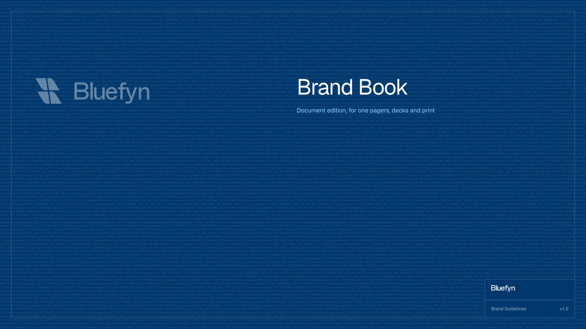
  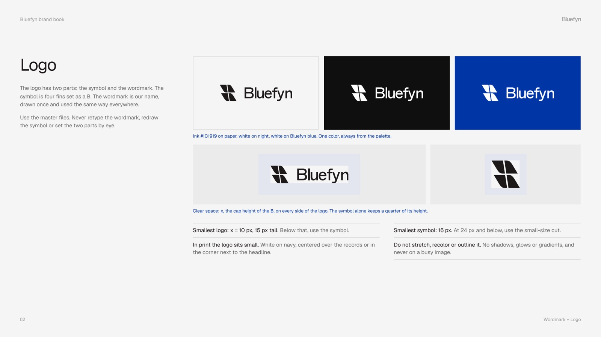
</p>
<p>
  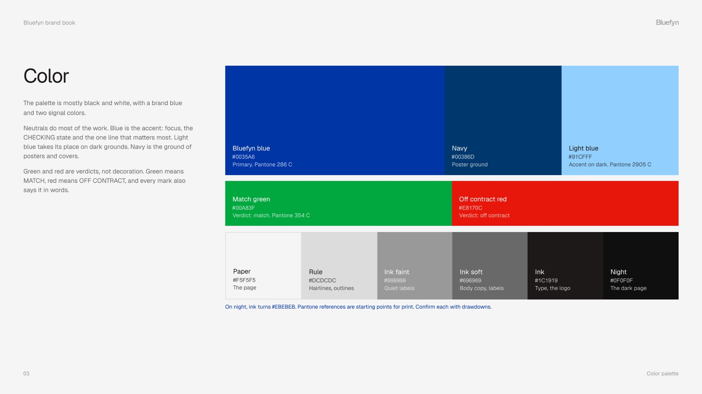
  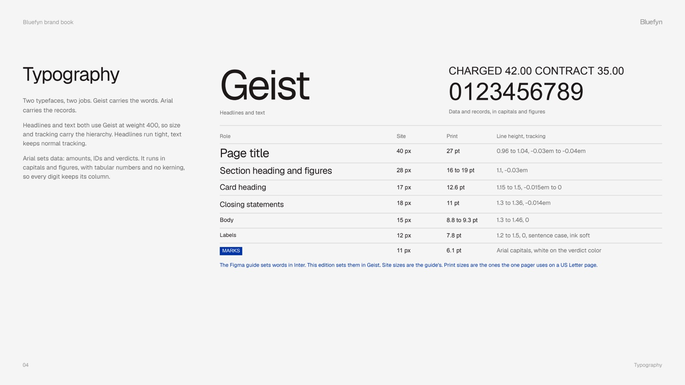
</p>
<p>
  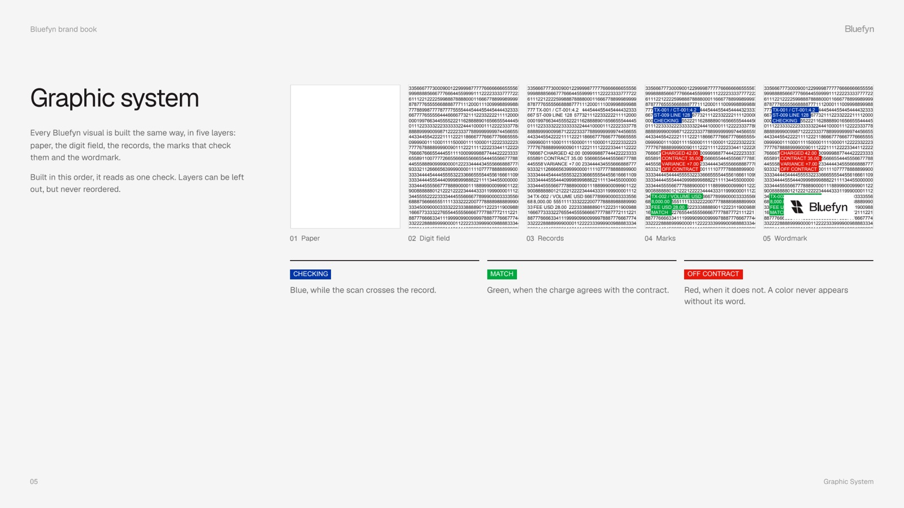
  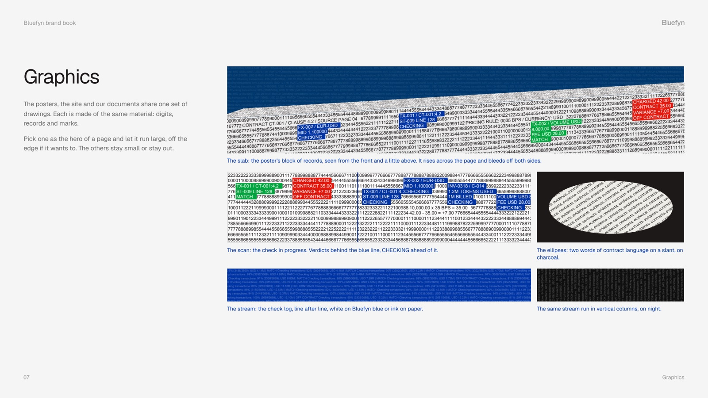
</p>
<p>
  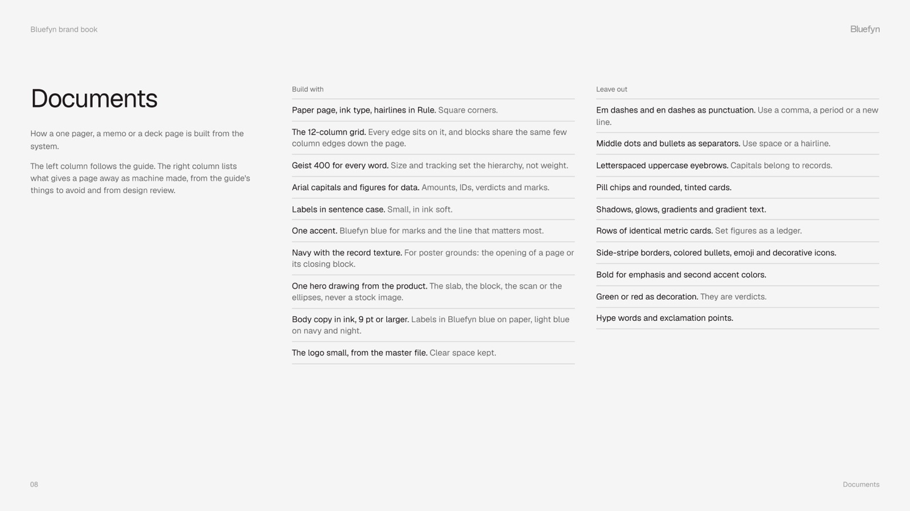
  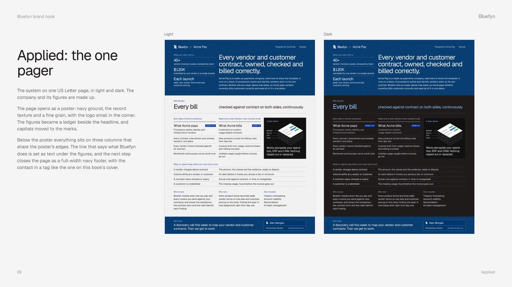
</p>

The brand in short:

- **Color.** Ink, paper and navy do most of the work. Bluefyn blue `#0035A6` is the one accent. Green and
  red mean MATCH and OFF CONTRACT and never decorate.
- **Type.** Geist at weight 400 for every word. Arial capitals for data.
- **Graphics.** No photos. Every drawing is made of digits, records and verdict marks, like the cube in the
  banner above.
- **Layout.** A shared grid, square corners, hairlines, and a fine grain on every ground.

## Brand files

The finished brand files come with the skill, in
[skills/bluefyn-design/assets/brand](skills/bluefyn-design/assets/brand), so Claude hands over the real
file instead of drawing a new one:

| Folder | What is in it |
| --- | --- |
| `logo/` | The logo, the symbol, a symbol for small sizes and the wordmark, in ink, white and blue, as SVG, PNG and PDF |
| `avatars/` | Profile pictures for LinkedIn, Slack and X, on blue, night and paper |
| `banners/` | Header images for a LinkedIn page, a LinkedIn profile and an X profile |
| `patterns/` | Five vector patterns at 1600 x 800: the stream and the tower of records |

[assets.md](skills/bluefyn-design/references/assets.md) lists every file with its size and use.
[BRAND.md](BRAND.md) says what you can and cannot do with them.

## Fonts

The brand uses two typefaces. Geist sets every word, at weight 400. Arial sets data: amounts, IDs and
verdict marks.

Geist comes with this repo, in [skills/bluefyn-design/assets/fonts](skills/bluefyn-design/assets/fonts),
so nothing has to be downloaded:

- `Geist-Variable.woff2` is the file the skills use. The one pager builder embeds it in every HTML file
  and PDF it writes, so the page looks the same on a machine that does not have Geist. The builder
  reports a problem if a PDF comes out without it.
- `Geist-Regular.ttf` is for your computer. Double-click it to install Geist, then pick it in Figma,
  Keynote, PowerPoint or Word when you design something by hand.
- `tokens.css` in the assets folder loads the woff2 for web pages.

Do not swap Geist for Inter, Helvetica or a system font. If a page shows another typeface, the font did
not load, and the page is not ready to send. Arial is on every Mac and Windows machine and needs no file.

Geist is made by Vercel and licensed under the SIL Open Font License, which allows this.

## Install

You need:

- Claude Code
- Python 3 (the system Python on macOS works)
- Chrome, Chromium, Edge or Brave, which the one pager skill uses to print the PDF

The skills need no Python packages and install nothing else.

1. Clone the repo.

   ```bash
   git clone https://github.com/bluefyn/design-skills.git
   ```

2. Run the installer from the repo folder. It copies the four skills into `~/.claude/skills`.

   ```bash
   cd design-skills && ./install.sh
   ```

3. Start a new Claude Code session and type `/bluefyn`. The four skills appear in the menu.

To install into one repo instead, so that everyone who works in it gets the skills:

```bash
./install.sh --project /path/to/repo
```

The installer skips a skill that is already installed. To update, pull the repo and run the installer
with `--force`:

```bash
git pull && ./install.sh --force
```

To uninstall, delete the four `bluefyn-*` folders from `~/.claude/skills`.

### Make a design workspace

A workspace is a folder set up for making Bluefyn pieces with Claude on your computer. The skills are
installed inside it, so they are active whenever Claude runs there, and they read the brand files from
the same folder.

```bash
./install.sh --workspace ~/bluefyn-design
```

Without a clone, pipe the installer from GitHub. It downloads the pack, builds the workspace and removes
the download:

```bash
curl -fsSL https://raw.githubusercontent.com/bluefyn/design-skills/main/install.sh | sh -s -- --workspace ~/bluefyn-design
```

The workspace looks like this:

```
bluefyn-design/
  .claude/skills/   the four skills
  brand/            logo, profile pictures, banners, patterns, the Geist font, tokens.css, brand-book.pdf
  content/          the text of each one pager, with the Acme Pay example
  out/              what gets built
  build.sh          builds a one pager: ./build.sh content/acme.json
  CLAUDE.md         tells Claude how to work in the folder
```

`brand/` links to the files inside the `bluefyn-design` skill, so there is one copy of each and the
skills and the folder never disagree. Open the folder in Claude Code and ask for a one pager, a logo
file or a slide. Finished files land in `out/`.

To update a workspace, run the same command with `--force`. It replaces the skills, `brand/` and
`build.sh`, and leaves `content/`, `out/` and `CLAUDE.md` alone.

### Install as a plugin

The repo is also a Claude Code plugin marketplace. In Claude Code, run:

```
/plugin marketplace add bluefyn/design-skills
/plugin install bluefyn@bluefyn-design-skills
```

Claude Code puts the plugin name in front of plugin skills, so the commands become
`/bluefyn:bluefyn-one-pager`, `/bluefyn:bluefyn-bro` and so on. Use `install.sh` if you want the short
names.

## Prompts to try

One pagers:

> Make a one pager for Acme Pay from these call notes: ...

> Here is our old sales PDF (path). Turn it into a one pager in our brand, light and dark.

> Turn this email thread into a one pager I can send to their CFO. Keep my numbers exactly.

> The one pager is 20 points too tall. Show me two ways to cut it.

> I want a bigger headline and the flags table above the two columns, just for this deal. Make me a local kit and change it there.

Other design work:

> Design a title slide for our board deck in the Bluefyn brand.

> Restyle this landing page section so it looks like us. Use the brand tokens.

> What does the brand say about using green and red?

> Draw the cube of records as an SVG, 300 points wide.

> Give me the white logo as a PNG and the X header on the night ground.

> Use the tower pattern as the background of this title slide.

Writing:

> /bluefyn-unslop this PR description

> Write the release note, then run it through bluefyn-unslop.

> /bluefyn-bro

## Build a one pager by hand

The one pager skill is a script and a content file. You can run it without Claude:

```bash
python3 skills/bluefyn-one-pager/scripts/one_pager.py skills/bluefyn-one-pager/examples/acme.json --out ./out --mode both
```

It writes `one-pager-acme-pay-light.pdf` and `one-pager-acme-pay-dark.pdf`, a PNG preview of each, and a
report that says whether the content fits on the page:

```
[light] density=regular spare=23.02pt (needs 12pt) pages=1 headline=3 lines fits=yes
[dark] density=regular spare=23.02pt (needs 12pt) pages=1 headline=3 lines fits=yes
```

Copy `acme.json`, change the text and build again.
[content-schema.md](skills/bluefyn-one-pager/references/content-schema.md) lists every field.

## Tune the template for yourself

The template in the skill is the shared design. To change the layout for your own page, make a local kit:

```bash
python3 skills/bluefyn-one-pager/scripts/one_pager.py init ./one-pager-kit
```

The kit is a folder with its own copy of the template, the brand code, the assets and the example
content. Edit `one_pager.py` in the kit (the `CSS` block holds every size, color and gap) and rebuild:

```bash
python3 ./one-pager-kit/one_pager.py ./one-pager-kit/content.json --out ./one-pager-kit/out --mode both
```

Your changes stay in the kit. The installed skills do not change.

## What is in the repo

```
skills/
  bluefyn-design/
    SKILL.md                      how Claude designs for Bluefyn
    references/brand.md           the brand rules
    references/brand-book.pdf     the illustrated brand book
    references/frontend-design.md the design method
    references/graphics.md        the brand drawings and how to draw them
    references/assets.md          the ready-made brand files and which one to pick
    scripts/brand.py              colors, logo and drawings as SVG
    assets/                       logo, Geist font (woff2 and ttf), tokens.css, grain and texture images
    assets/brand/                 logo files, profile pictures, banners and patterns, ready to use
  bluefyn-one-pager/
    SKILL.md                      how Claude turns text into a one pager
    references/content-schema.md  every field of the content file and how much text fits
    scripts/one_pager.py          content file in, PDF and preview out
    examples/                     the Acme Pay sample, as JSON, PDF and image
  bluefyn-unslop/SKILL.md
  bluefyn-bro/SKILL.md
workspace/                        the CLAUDE.md, README and build script of a design workspace
docs/                             the banner, logo and screenshots in this README
install.sh                        installs the skills, or makes a design workspace
```

`bluefyn-one-pager` reads its colors, logo and font from `bluefyn-design`, so install them together.

## Use it for your own brand

The approach works for any brand: write the rules down where Claude reads them, code the approved layout
once, and let the content change. Fork the repo, then replace `references/brand.md`, the logo, the colors
in `brand.py` and `tokens.css`, and the font. [BRAND.md](BRAND.md) says what you can and cannot reuse.

## Contributing

Issues and pull requests are welcome for the builder, the installer and the docs. A change to the brand
rules or to the look of the template needs a sign-off from Bluefyn, so open an issue first and include a
before and after image.

To check a change, build the example and read the report:

```bash
python3 skills/bluefyn-one-pager/scripts/one_pager.py skills/bluefyn-one-pager/examples/acme.json --out ./out --mode both
```

## License and credits

The code and the skill text are under the [MIT license](LICENSE). The Bluefyn name, logo and brand book
are Bluefyn's brand and are not part of that license. See [BRAND.md](BRAND.md).

- `references/frontend-design.md` is Anthropic's `frontend-design` skill, under the Apache License 2.0.
  The license is in `skills/bluefyn-design/LICENSE-frontend-design.txt`.
- `bluefyn-unslop` and `bluefyn-bro` come from pstack by Lauren Tan, under the MIT license.
  `bluefyn-unslop` has our edits. See [THIRD-PARTY.md](THIRD-PARTY.md).
- Geist is under the SIL Open Font License 1.1. The license is next to the font.

<p align="center">
  <br>
  <a href="https://bluefyn.ai">
    <picture>
      <source media="(prefers-color-scheme: dark)" srcset="docs/logo-white.svg">
      
    </picture>
  </a>
  <br>
  <sub>Bluefyn checks every fee you pay and every invoice you send against your contracts.</sub>
</p>
